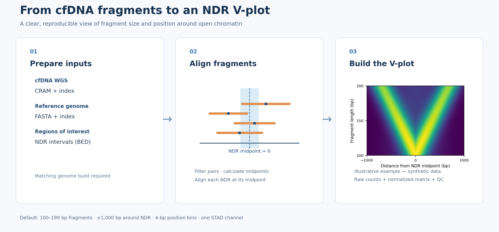

# NDR V-plot pipeline

A Snakemake workflow for generating fragment midpoint × length matrices around user-supplied NDRs from indexed cfDNA WGS CRAM files. This is an independent, methods-inspired implementation, not a verified reproduction of Bae et al. or their trained CNN.



## Method

- Use BED coordinates and a matched reference assembly. Each interval midpoint defines zero.
- Retain mapped, primary, nonduplicate, non-QC-failed proper pairs with MAPQ ≥30 for both mates; validate pair and TLEN consistency.
- Count each valid fragment once per NDR using the fragment midpoint. A fragment may contribute to multiple overlapping NDR windows.
- Defaults: 100 ≤ fragment length < 200 bp (1-bp bins), positions −1,000 ≤ x < +1,000 bp (4-bp bins): 100 × 500 cells per channel.
- Sum counts across regions; save raw counts and sample-wide min–max normalization. No GC correction, smoothing or blacklist filter is applied.

The paper describes ±1,000 bp, 4-bp bins and 250 bins, which do not all agree arithmetically; this implementation uses 500 position bins. The paper's preprocessing and publicly available model scaling cannot be confirmed as identical to this implementation. A single-tissue matrix is not input to the paper's 25-channel trained model.

## Requirements

Python, Snakemake, numpy, pysam and matplotlib; indexed CRAM/CRAI, matching FASTA/FAI and a BED of regions. Prepare the software environment in advance for offline servers.

```bash
conda env create -f environment.yaml
conda activate ndr-vplot
python test_synthetic.py
```

Check the environment name in `environment.yaml` if it differs from the command above.

## Run

1. Copy `examples/config.json` and `examples/samples.tsv` into a private run directory. Replace all example paths and sample names.
2. Set `samples`, `reference`, `bed` and `output_dir`. `samples.tsv` must have tab-separated `sample` and `cram` columns.
3. Preview and execute:

```bash
python run_workflow.py --config /path/to/config.json
python run_workflow.py --config /path/to/config.json --run
```

The example schedules at most four samples with four HTSlib threads each; memory settings are scheduler reservations, not hard limits. The fragment counting loop is sequential per sample. Missing CRAMs or indexes are recorded and skipped; inspect `workflow_inputs/input_audit.tsv`.

## Outputs

For each completed sample under `output_dir/samples/<sample>/`: `vplot.npz` (raw counts, normalized matrix and bin edges), `regions.tsv`, `run.json`, `vplot_channel01.png` and `COMPLETE.json`. Workflow logs and benchmarks are retained separately.

## Data and publication

No patient data, clinical tables, CRAMs or reference BED are included. Obtain and validate a BED separately; the original STAD list and any derived BED may have terms governing redistribution. Review all files and provenance before publishing. No software license is supplied: the owner must choose an appropriate license after checking dependencies and ownership.

## References

- Bae et al. *Nature Communications* (2023), [10.1038/s41467-023-37768-3](https://doi.org/10.1038/s41467-023-37768-3); [authors’ repository](https://github.com/kaistomics/cfWGS).
- Henikoff et al. *PNAS* (2011), [10.1073/pnas.1110731108](https://doi.org/10.1073/pnas.1110731108).

## Group V-plot visualization

After sample-level runs, prepare a tab-separated file with `sample`, `group`, and `npz` columns; see `examples/group_manifest.tsv`. List groups in the desired display order. Provide 2–6 groups and unique sample IDs. Use matching region BED, reference and processing settings. Existing validated NPZ files can be used without re-running CRAM.

```bash
python scripts/group_vplot_compare.py --manifest /path/to/groups.tsv --output /path/to/new_comparison
```

The output contains group mean V-plots and pairwise difference heatmaps in PNG/PDF, group matrices, sample audit, input SHA-256 and comparison metadata. Each patient is normalized across all matrix pixels and channels using sample-wide min–max, then receives equal weight in its group. The first colorbar is shared across group means and the second uses a shared symmetric zero-centered scale for all differences. No smoothing is applied. Group subtraction is descriptive; no PERMANOVA or pairwise/pixel-wise statistical test is performed. Verify assay settings and sampling times. Missing BED provenance is reported as a warning; incompatible known BED hashes or bin edges stop the run.
